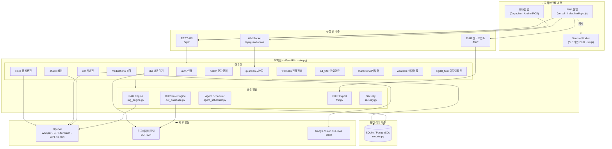
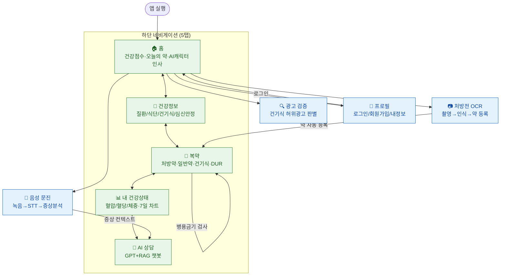
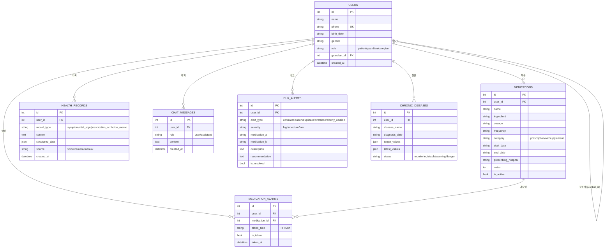
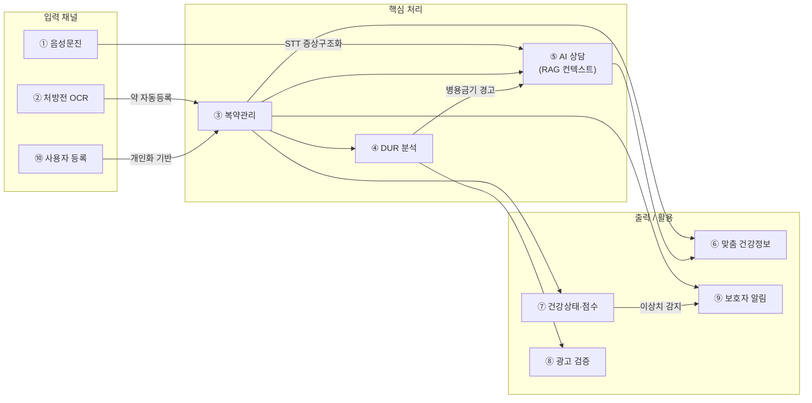
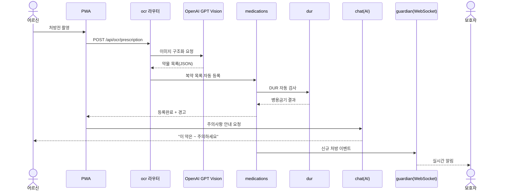

# 손주약방 설계 도면 (Blueprint)

> 고도화(2차 개발) 착수 전 기준 설계도. 현재 코드베이스 기준으로 작성.
> GitHub/VSCode Mermaid 미리보기로 렌더링됩니다.

- 대상: `C:\Users\오창민\Desktop\여성발명\TalkFile_sonju-yakbang\sonju-yakbang`
- 스택: PWA(정적 HTML/CSS/JS) + Capacitor 모바일 / FastAPI(Python) + SQLAlchemy + APScheduler + WebSocket / SQLite(MVP)→PostgreSQL(운영)
- 작성 기준일: 2026-09-07

---

## 1. 시스템 아키텍처 도면

---

## 2. 화면 흐름 / UI 와이어프레임 (Screen Flow)

---

## 3. 데이터 모델 도면 (ERD)

---

## 4. 기능 연계 흐름도 (Data Flow / Sequence)

### 4-1. 핵심 데이터 흐름

### 4-2. 시나리오: 처방전 → 안전성 확인 → 복약 시작

---

## 5. 고도화(2차) 확장 포인트

| 영역 | 현재 | 고도화 방향 |
|------|------|-------------|
| DB | SQLite 단일 파일 | PostgreSQL 전환 · 마이그레이션(Alembic) |
| 인증 | phone 기반 단순 | JWT/OTP 세션, 보호자-환자 권한 분리 |
| 웨어러블 | wearable 라우터(스텁) | 실기기 연동 → HEALTH_RECORDS 자동 입력 |
| 디지털 트윈 | digital_twin 라우터 | 통합 건강모델 시뮬레이션 고도화 |
| FHIR | Patient/Medication/Observation | 병원 EMR 양방향 연동 |
| 알림 | WebSocket | FCM 푸시 · 지자체 돌봄 연계 |

*작성: Claude Code · 기준 커밋 기준 코드 분석*
